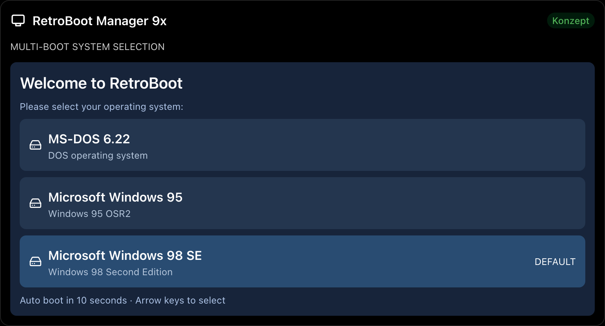
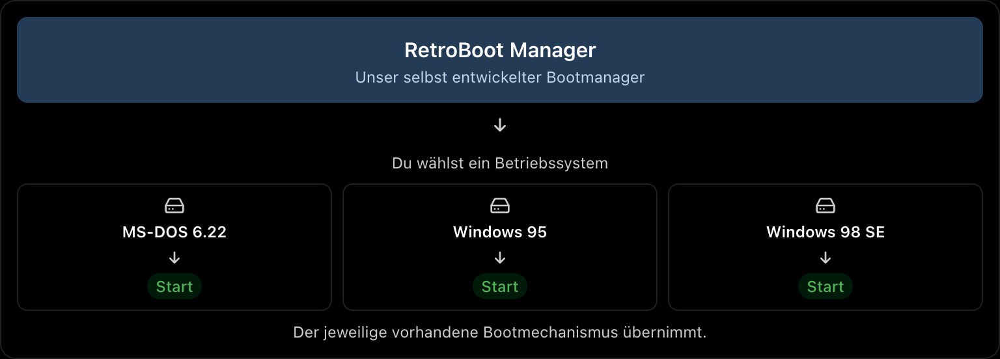
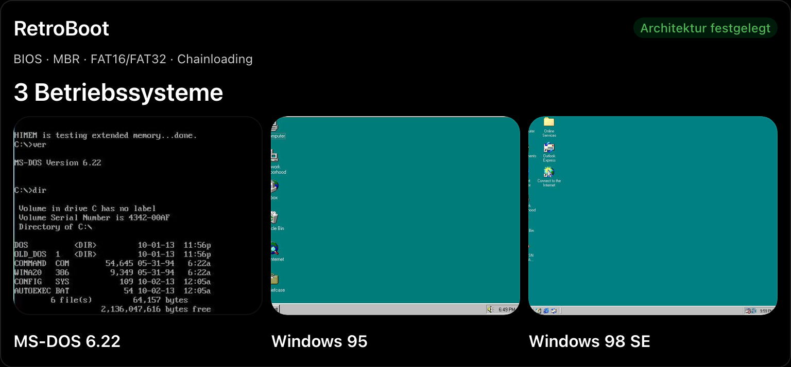
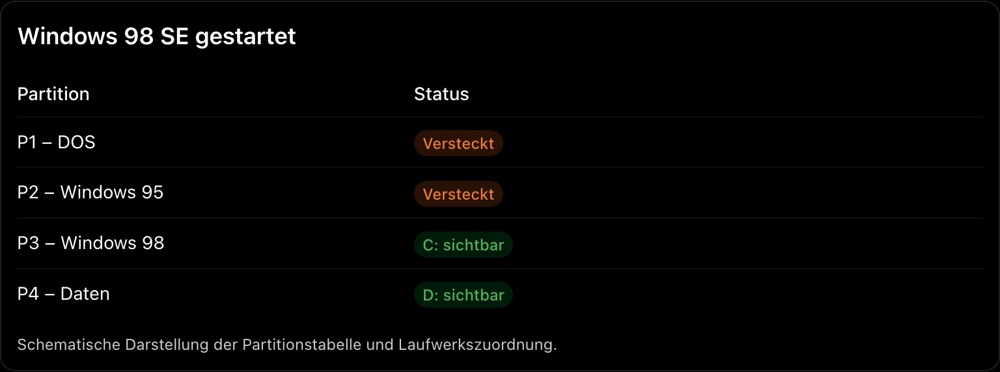
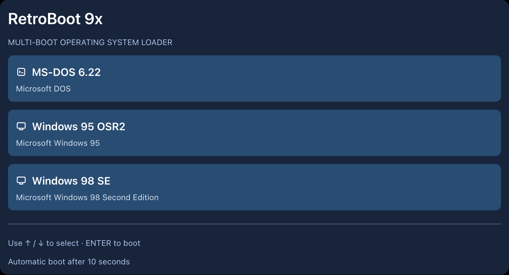
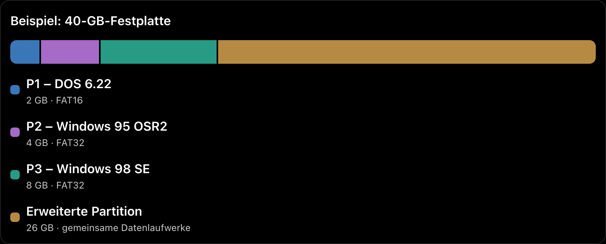
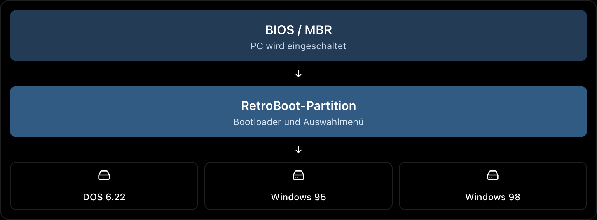

Ja\! 😊 ChatGPT Pro kann dir dabei helfen, einen eigenen Windows-9x-Bootmanager zu entwickeln, mit dem du DOS, Windows 95 und Windows 98 parallel auf einem PC installieren und beim Start auswählen kannst.

Das ist technisch durchaus machbar. Wir können sogar einen eigenen Bootmanager entwickeln, statt uns ausschließlich auf bestehende Lösungen zu verlassen.

## So könnte dein Bootmanager aussehen

## Was wir entwickeln könnten

- Eigenständiger Bootmanager mit DOS-artigem Menü.
- Unterstützung für MS-DOS 6.22.
- Windows 95 (OSR2).
- Windows 98 SE.
- Einstellbare Bootreihenfolge und Wartezeit.
- Eigene Konfigurationsdatei.
- Installation auf MBR-Festplatten.
- Unterstützung für FAT16 und FAT32.
- Tastatursteuerung ohne Maus.

## Technischer Aufbau

Ich würde eine klassische BIOS/MBR-Lösung vorschlagen:

1. Eigener Bootsektor (Stage 1).
2. Bootloader (Stage 2).
3. Betriebssystem-Auswahlmenü.
4. Chainloading der jeweiligen DOS-/Windows-Bootpartition.

Wichtig: Windows 95 und 98 teilen sich teilweise Bootdateien und Systempartitionen. Für eine saubere parallele Installation sollten wir getrennte primäre Partitionen vorsehen und die jeweils nicht verwendeten Partitionen gegebenenfalls verstecken.

## Eine wichtige Frage zur Entwicklung

Wie weit soll das Projekt gehen?

1. Was soll ChatGPT entwickeln?

full Kompletten eigenen Bootmanager inklusive Bootloader

Bootmanager mit eigenem Auswahlmenü und Chainloading

Bootmanager inklusive Installationsprogramm

2. Welche Hardware?

Klassischer PC mit BIOS und MBR

VirtualBox / VMware / 86Box

both Echte Hardware und virtuelle Maschinen

3. Welches Design?

Original Windows-9x-/DOS-Stil

Modernes grafisches Menü

text Klassisches DOS-Textmenü

 Projekt starten

Wir können das tatsächlich als richtiges Softwareprojekt mit Quellcode, Build-System, Dokumentation und bootfähigem Image umsetzen.

## Erläuterung

Kein Problem\! 😊 Ich erkläre dir die drei Möglichkeiten ganz einfach.

Es geht darum, wie viel von dem Bootmanager wir selbst programmieren.

### 1. Kompletter eigener Bootmanager

Wir programmieren alles selbst:

- Den Startmechanismus direkt nach dem Einschalten des PCs.
- Die Betriebssystem-Erkennung.
- Das Auswahlmenü.
- Das Laden von DOS, Windows 95 und Windows 98.

Das wäre ein eigenständiges Bootmanager-Projekt.

### 2. Bootmanager mit Chainloading

Wir programmieren ein eigenes Auswahlmenü. Wenn du beispielsweise Windows 98 auswählst, übergibt unser Bootmanager den Start an den vorhandenen Windows-98-Bootloader.

- Weniger eigener Low-Level-Code.
- Einfacher zu entwickeln.
- Nutzt vorhandene Bootmechanismen.

### 3. Bootmanager inklusive Installationsprogramm

Hier geht es noch einen Schritt weiter:

- Eigener Bootmanager.
- Eigenes Installationsprogramm.
- Partitionen vorbereiten.
- DOS, Windows 95 und Windows 98 einrichten.
- Bootmenü automatisch konfigurieren.

Das wäre quasi ein komplettes Retro-Multiboot-System.

## Meine Empfehlung

Ich würde Variante 1 oder 3 empfehlen, wenn du ein richtig eigenständiges Projekt möchtest.

Eine Frage noch: Soll unser Bootmanager auch die Installation von DOS, Windows 95 und Windows 98 automatisch vorbereiten und konfigurieren können, oder möchtest du die Betriebssysteme selbst installieren und nur den Bootmanager dafür haben?

## Chainloading

Chainloading bedeutet ganz einfach: Unser Bootmanager startet einen anderen Bootloader, der dann das Betriebssystem startet.

Stell dir das wie einen Vermittler vor.

## Beispiel ohne Chainloading

Unser eigener Bootmanager müsste selbst wissen, wie er DOS, Windows 95 und Windows 98 vollständig startet.

## Beispiel mit Chainloading

## Und was bedeutet deine Entscheidung für Variante 3?

Wir könnten eine Kombination bauen:

- Einen eigenen Bootmanager mit Chainloading.
- Ein eigenes Installationsprogramm.
- Automatische Partitionierungsvorbereitung.
- Installationseinrichtung für DOS, Windows 95 und Windows 98.
- Automatische Erkennung der installierten Systeme.
- Automatische Einrichtung des Bootmenüs.

Meine Empfehlung: Wir verwenden Chainloading. Das macht unser Projekt zuverlässiger und reduziert unnötige Komplexität. Das Installationsprogramm und das Bootmenü bleiben trotzdem vollständig unsere eigene Entwicklung.

So bekommen wir ein richtiges eigenes Retro-Multiboot-System. 😎

## Installation der Betriebssysteme

Genau\! 👍 Du hast das Prinzip richtig verstanden. Die Windows-Installationen sollen im Grunde ganz normal ablaufen. Unser Installationsprogramm muss lediglich dafür sorgen, dass die richtige Partition vorbereitet und aktiviert ist.

Ich würde das bei unserem RetroBoot-Projekt etwas komfortabler lösen.

### 1. Beispiel für die Festplattenaufteilung

Wir könnten eine Festplatte mit beispielsweise 40 GB so aufteilen:

| Partition | Größe | Verwendung |
| --- | --- | --- |
| C: | 2 GB | MS-DOS 6.22 |
| D: | 4 GB | Windows 95 |
| E: | 8 GB | Windows 98 SE |
| Rest | 26 GB | Daten |

Die drei Betriebssysteme bekommen jeweils eine eigene primäre Partition.

Wichtig: Für DOS 6.22 und Windows 95/98 müssen wir die jeweiligen FAT16-/FAT32-Kompatibilitätsgrenzen beachten. Außerdem sollten wir die Laufwerksbuchstaben durch gezieltes Verstecken nicht aktiver Partitionen kontrollieren.

### 2. Wie läuft die Installation ab?

Hier kommt unser Bootmanager ins Spiel.

#### RetroBoot – Installationsablauf

1. RetroBoot installieren
   Bootmanager und Installationsumgebung auf der Festplatte einrichten.
2. Windows 95 auswählen
   Das Installationsprogramm bereitet die Windows-95-Partition vor und aktiviert sie.
3. Windows 95 ganz normal installieren
   Du startest das normale Windows-95-Setup von CD-ROM.
4. Windows 98 installieren
   Wieder RetroBoot starten, Windows-98-Partition auswählen und das normale Setup ausführen.
5. DOS installieren
   Dasselbe Prinzip für MS-DOS 6.22.
6. Bootmenü vervollständigen
   RetroBoot erkennt die Installationen und nimmt sie ins Auswahlmenü auf.

### 3. Muss man die aktive Partition umstellen?

Ja, bei einer klassischen BIOS/MBR-Installation ist das ein wichtiger Punkt.

Normalerweise startet das BIOS den MBR, der anschließend den Bootsektor der aktiven primären Partition lädt.

Unser RetroBoot kann die Partitionierung und Aktivierung verwalten. Allerdings gibt es einen wichtigen Unterschied:

- Die aktive Partition bestimmt bei einem klassischen MBR-Bootverfahren, welche Partition gestartet wird.
- Chainloading kann gezielt den Bootsektor einer anderen Partition starten.
- Das bloße Aktivieren einer Partition reicht nicht immer aus, um die anderen Windows-Installationen sauber voneinander zu isolieren.

Ich würde deshalb eine automatische Partitionierungsverwaltung mit versteckten Nicht-Zielpartitionen vorsehen. So sieht jede Windows-Installation möglichst nur ihre eigene Systempartition und die gewünschten weiteren Laufwerke.

### 4. Eine wichtige Designentscheidung

Ich würde gerne noch eine Sache für RetroBoot festlegen:

Wie sollen sich die Betriebssysteme gegenseitig sehen?

isolated Getrennte Systeme (meine Empfehlung)

Windows 95 sieht Windows 98 nicht und umgekehrt. Jedes System bekommt seine eigene Systempartition als C:.

Alle Systeme sichtbar

Windows 95 und 98 können die jeweils anderen Installationen und deren Dateien sehen.

Kombination

Eigene Systempartitionen, aber eine gemeinsame Datenpartition für alle Betriebssysteme.

 Diese Variante verwenden

Damit können wir RetroBoot von Anfang an so entwickeln, dass nicht nur das Bootmenü, sondern auch die parallelen Windows-Installationen zuverlässig funktionieren.

## Entscheidung

Perfekt\! Dann legen wir RetroBoot auf ein echtes isoliertes Multi-Boot-System für DOS, Windows 95 und Windows 98 SE aus.

Das ist eine sehr gute Architekturentscheidung. Jedes Betriebssystem bekommt seine eigene Systempartition und soll beim Start den Laufwerksbuchstaben `C:` erhalten. Die jeweils anderen Systempartitionen werden versteckt.

Ich würde RetroBoot so entwickeln, dass du die Betriebssysteme nacheinander installieren kannst, ohne jedes Mal den Bootmanager neu installieren zu müssen.

# RetroBoot – Technisches Konzept 1.0

## 1. Festplattenaufteilung

Als Ausgangspunkt nehmen wir eine klassische BIOS/MBR-Festplatte mit 40 GB.

| Partition | Größe | Dateisystem | Zweck |
| --- | --- | --- | --- |
| P1 | 2 GB | FAT16 | MS-DOS 6.22 |
| P2 | 4 GB | FAT16 | Windows 95 |
| P3 | 8 GB | FAT32 | Windows 98 SE |
| P4 | 26 GB | FAT32 | Gemeinsame Daten |

Die Größen sind Beispielwerte und können später angepasst werden.

Wichtig ist die historische Kompatibilität: DOS 6.22 unterstützt FAT32 nicht. Windows 95 muss je nach Version ebenfalls berücksichtigt werden. Für OSR2 und Windows 98 ist FAT32 verfügbar.

Die vier primären Partitionen nutzen die klassische MBR-Partitionstabelle vollständig aus.

Eine wichtige Korrektur zur Partitionstabelle: P4 sollte eine erweiterte Partition sein, in der sich das gemeinsame FAT32-Datenlaufwerk als logisches Laufwerk befindet. So bleiben wir innerhalb der vier MBR-Partitionseinträge.

Außerdem würde ich für Windows 95 ausdrücklich OSR2 vorsehen, damit wir FAT32-Unterstützung haben.

## 2. Wie die Isolation funktioniert

Das ist das Herzstück von RetroBoot.

Beispiel: Du wählst Windows 98 SE.

Wenn du anschließend Windows 95 auswählst, ändert RetroBoot die Sichtbarkeit:

- DOS wird versteckt.
- Windows 98 wird versteckt.
- Windows 95 wird als C: eingeblendet.
- Die Datenpartition bleibt sichtbar.

Das geschieht bereits vor dem Start des jeweiligen Betriebssystems.

Technisch verwendet RetroBoot dafür die Partitionstypen für versteckte FAT-Partitionen und verwaltet die aktive Partition. Das ist zuverlässiger als lediglich die Laufwerksbuchstaben nachträglich zu verändern.

## 3. Der Installationsablauf

Ich würde einen eigenen RetroBoot-Installer entwickeln, der dich durch folgende Schritte führt:

## RetroBoot Setup

1. Festplatte vorbereiten
   MBR-Partitionstabelle anlegen, Partitionen formatieren und Bootmanager installieren.
2. MS-DOS 6.22 installieren
   DOS-Partition einblenden, aktivieren und das originale DOS-Setup starten.
3. Windows 95 OSR2 installieren
   Windows-95-Partition einblenden und als C: vorbereiten. Normales Windows-Setup starten.
4. Windows 98 SE installieren
   Windows-98-Partition einblenden und das originale Windows-98-Setup starten.
5. Bootmanager wiederherstellen und konfigurieren
   Falls ein Betriebssystem den Bootsektor oder MBR verändert hat, wird RetroBoot wieder eingerichtet.
6. Abschluss
   Alle drei Systeme erkennen, isolieren und in das Bootmenü aufnehmen.

Eine Besonderheit: Wir müssen den RetroBoot-Bootcode gegen Überschreiben durch Installationsprogramme absichern. Deshalb bekommt unser Installer eine Wiederherstellungsfunktion.

## 4. Was passiert beim Neustart?

Das Menü könnte beispielsweise so aussehen:

## 5. Eine weitere wichtige technische Feinheit

Für das gemeinsame Datenlaufwerk müssen wir die Dateisysteme berücksichtigen:

- DOS 6.22 kann kein FAT32 lesen.
- Windows 95 OSR2 kann FAT32 lesen.
- Windows 98 SE kann FAT32 lesen.

Deshalb würde ich die Datenpartition aufteilen:

| Laufwerk | Dateisystem | Zugriff |
| --- | --- | --- |
| D: | FAT16, 2 GB | DOS, Windows 95, Windows 98 |
| E: | FAT32, Rest | Windows 95, Windows 98 |

Damit können alle drei Betriebssysteme auf einen gemeinsamen Datenbereich zugreifen, während Windows 95 und 98 zusätzlich den größeren Speicher nutzen können.

## 6. Meine geplante Softwarearchitektur

Ich würde RetroBoot in fünf Komponenten aufteilen:

1. RetroBoot MBR: Erster Startcode.
2. RetroBoot Loader: Lädt den eigentlichen Bootmanager.
3. RetroBoot Menu: Betriebssystemauswahl.
4. RetroBoot Partition Manager: Aktiviert und versteckt Partitionen.
5. RetroBoot Installer: Installiert und konfiguriert das gesamte System.

Die Installationsmedien von DOS, Windows 95 und Windows 98 bleiben dabei original. Wir bauen also keinen Windows-Installer nach, sondern eine eigene Installationsumgebung, die die Original-Setups vorbereitet und startet.

## 7. Noch eine Entscheidung für unser Projekt

Ich würde gerne auch die Hardwarekompatibilität festlegen.

Welche Hardware soll RetroBoot unterstützen?

Nur echte ältere PCs mit klassischem BIOS

Nur virtuelle Maschinen (86Box, PCem, VMware)

both Beides – echte Hardware und virtuelle Maschinen

Welche Festplatten?

ide IDE / ATA (klassische Retro-PCs)

IDE und SATA

IDE, SATA und virtuelle Festplatten

 Hardwarekonzept festlegen

Mein Ziel wäre, dass wir am Ende ein bootfähiges RetroBoot-ISO und einen installierbaren Bootmanager haben, inklusive Quellcode und Build-Anleitung.

## Recap

Alles klar – diese Entscheidung ist jetzt die feste Grundlage für RetroBoot. 😊

Wir behalten die Architektur mit drei vollständig getrennten Systempartitionen und einer gemeinsamen Datenpartition bei.

Ich würde allerdings die zuvor vorgeschlagene Partitionierung noch etwas präzisieren, damit DOS 6.22, Windows 95 OSR2 und Windows 98 SE zuverlässig damit arbeiten können.

### RetroBoot – Festplattenlayout

Die Datenpartition bekommt:

- Ein FAT16-Laufwerk für alle drei Betriebssysteme.
- Ein zusätzliches FAT32-Laufwerk für Windows 95 und Windows 98.

### Installationsablauf

1. RetroBoot richtet MBR und Partitionen ein.
1. DOS 6.22 wird auf P1 installiert.
1. Windows 95 OSR2 wird auf P2 installiert.
1. Windows 98 SE wird auf P3 installiert.
1. RetroBoot richtet die Partitionstypen, Sichtbarkeit und Startreihenfolge ein.
1. Der Bootmanager erhält alle drei Betriebssystemeinträge.

Bei jedem Installationsschritt wird nur die jeweilige Ziel-Systempartition eingeblendet. Die anderen Systempartitionen bleiben versteckt.

Wichtig: DOS 6.22 benötigt FAT16. Für Windows 95 OSR2 und Windows 98 SE können wir FAT32 einsetzen. Die Größen und Geometrie müssen wir bei der Implementierung anhand der tatsächlichen Festplatte und der BIOS-Grenzen validieren.

### Ein technischer Punkt, den ich fest einplanen möchte

RetroBoot muss auch nach einer Windows-Installation seinen eigenen Bootmanager wiederherstellen können. Windows-Setups können den MBR oder Bootsektor verändern.

Dafür bekommt RetroBoot eine eigene Reparaturfunktion.

Damit ist das grundlegende Partitions- und Installationskonzept festgelegt. Als nächsten Schritt sollten wir die technische Spezifikation und anschließend den ersten lauffähigen Bootloader entwickeln.

## Partition des Bootmanagers

Sehr gute Frage! 😊 RetroBoot selbst bekommt eine eigene Bootmanager-Partition, damit es unabhängig von DOS, Windows 95 und Windows 98 funktioniert.

Ich würde dafür folgende Aufteilung vorsehen:

Neue RetroBoot-Partitionierung

| Partition | Größe | Inhalt |
| --- | --- | --- |
| P1 | 64 MB | RetroBoot (FAT16) |
| P2 | 2 GB | MS-DOS 6.22 (FAT16) |
| P3 | 4 GB | Windows 95 OSR2 (FAT32) |
| P4 | 8 GB | Windows 98 SE (FAT32) |
| Erweiterte Partition | Rest | Gemeinsame Daten (FAT32, ohne DOS-Zugriff) |

Die 64 MB für RetroBoot enthalten:

- Bootmanager und Loader
- Konfigurationsdateien
- Reparaturprogramm
- Installationsverwaltung
- Diagnosewerkzeuge

Wie startet das System?

Warum eine eigene Partition?

- Windows kann RetroBoot nicht versehentlich überschreiben, solange die Partition versteckt ist.
- Die Bootmanager-Dateien bleiben von den Betriebssystemen getrennt.
- Wir können RetroBoot unabhängig reparieren und aktualisieren.
- Die drei Betriebssysteme bleiben voneinander isoliert.

**Eine wichtige technische Besonderheit:** Der erste Bootcode liegt trotzdem im MBR. Die eigene RetroBoot-Partition enthält den eigentlichen Loader und die Verwaltungssoftware. Der MBR-Code lädt diesen von dort.

Ich würde diese Architektur als Grundlage nehmen. So bleibt RetroBoot der zentrale Startpunkt, egal welches Betriebssystem du auswählst.