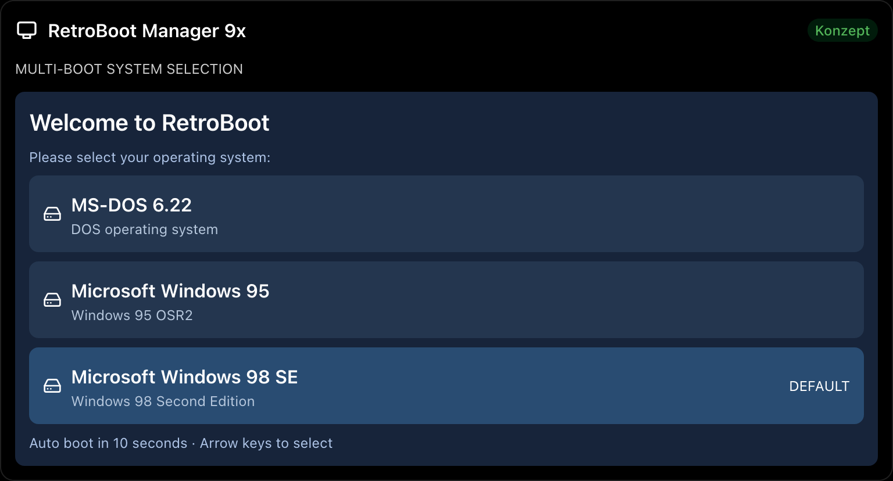
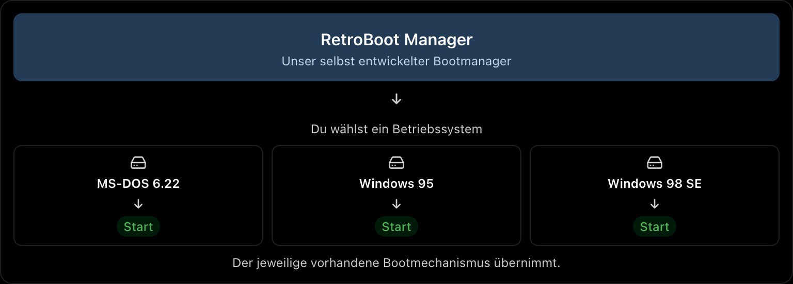
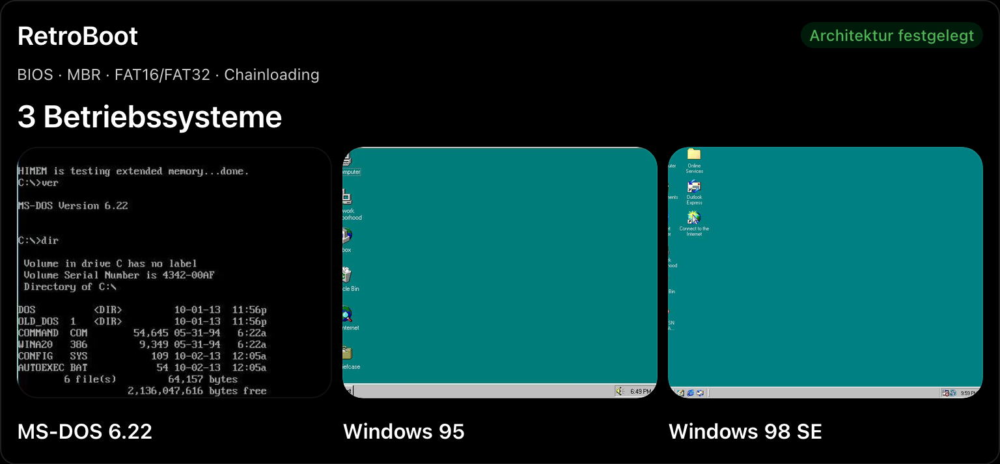
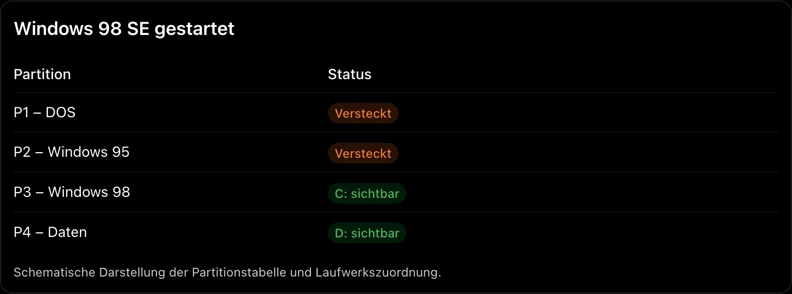
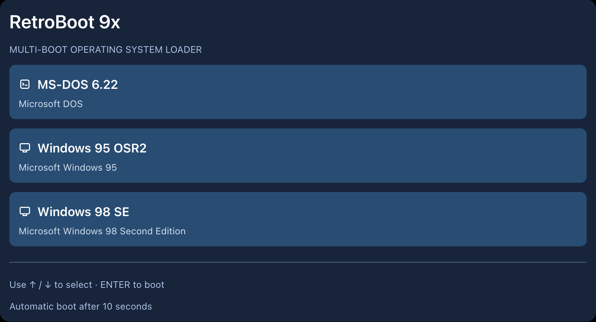
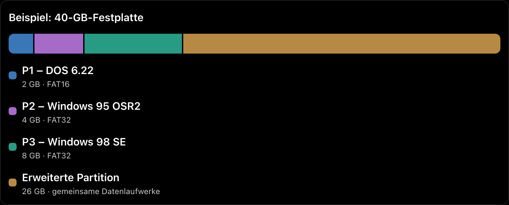
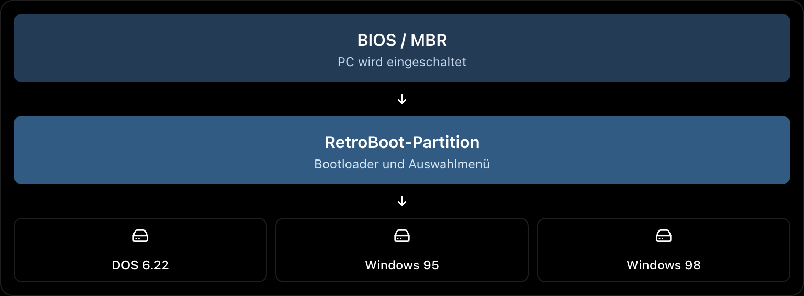

# Archivierte Gesprächsnotizen

Redaktioneller Hinweis (10. November 2026): Persönliche Anreden und
Gesprächsformulierungen wurden neutralisiert. Die ursprünglichen technischen
Vorschläge und Referenzbilder bleiben als Entstehungsgeschichte erhalten.
Insbesondere die alten 40-GB-Beispiele und widersprüchlichen MBR-Belegungen
sind keine aktuellen Vorgaben; maßgeblich ist die
[Spezifikation v0.2](../spec/RetroBoot_Phase1_Technische_Spezifikation_v0.2.md).

Die ursprüngliche Projektidee war ein eigener Windows-9x-Bootmanager, der die parallele Installation von DOS, Windows 95 und Windows 98 auf einem PC und die Auswahl beim Start ermöglichen sollte.

Vorgesehen war ein eigener Bootmanager als eigenständiges Softwareprojekt.

## Mögliche Oberfläche des Bootmanagers

## Vorgeschlagener Funktionsumfang

- Eigenständiger Bootmanager mit DOS-artigem Menü.
- Unterstützung für MS-DOS 6.22.
- Windows 95 (OSR2).
- Windows 98 SE.
- Einstellbare Bootreihenfolge und Wartezeit.
- Eigene Konfigurationsdatei.
- Installation auf MBR-Festplatten.
- Unterstützung für FAT16 und FAT32.
- Tastatursteuerung ohne Maus.

## Technischer Aufbau

Als Grundlage wurde eine klassische BIOS/MBR-Lösung vorgeschlagen:

1. Eigener Bootsektor (Stage 1).
2. Bootloader (Stage 2).
3. Betriebssystem-Auswahlmenü.
4. Chainloading der jeweiligen DOS-/Windows-Bootpartition.

Wichtig: Windows 95 und 98 teilen sich teilweise Bootdateien und Systempartitionen. Für eine saubere parallele Installation wurden getrennte primäre Partitionen und gegebenenfalls das Verstecken nicht verwendeter Partitionen vorgeschlagen.

## Eine wichtige Frage zur Entwicklung

Wie weit soll das Projekt gehen?

1. Was soll ChatGPT entwickeln?

full Kompletten eigenen Bootmanager inklusive Bootloader

Bootmanager mit eigenem Auswahlmenü und Chainloading

Bootmanager inklusive Installationsprogramm

2. Welche Hardware?

Klassischer PC mit BIOS und MBR

VirtualBox / VMware / 86Box

both Echte Hardware und virtuelle Maschinen

3. Welches Design?

Original Windows-9x-/DOS-Stil

Modernes grafisches Menü

text Klassisches DOS-Textmenü

 Projekt starten

Als Lieferumfang waren Quellcode, Build-System, Dokumentation und ein bootfähiges Image vorgesehen.

## Erläuterung

Zur Auswahl standen drei Möglichkeiten.

Sie unterscheiden sich im Umfang des selbst entwickelten Bootcodes.

### 1. Kompletter eigener Bootmanager

Alle Bestandteile werden selbst programmiert:

- Den Startmechanismus direkt nach dem Einschalten des PCs.
- Die Betriebssystem-Erkennung.
- Das Auswahlmenü.
- Das Laden von DOS, Windows 95 und Windows 98.

Das wäre ein eigenständiges Bootmanager-Projekt.

### 2. Bootmanager mit Chainloading

Ein eigenes Auswahlmenü übergibt den Start beispielsweise nach Auswahl von Windows 98 an dessen vorhandenen Bootloader.

- Weniger eigener Low-Level-Code.
- Einfacher zu entwickeln.
- Nutzt vorhandene Bootmechanismen.

### 3. Bootmanager inklusive Installationsprogramm

Hier geht es noch einen Schritt weiter:

- Eigener Bootmanager.
- Eigenes Installationsprogramm.
- Partitionen vorbereiten.
- DOS, Windows 95 und Windows 98 einrichten.
- Bootmenü automatisch konfigurieren.

Das wäre quasi ein komplettes Retro-Multiboot-System.

## Meine Empfehlung

Für ein eigenständiges Projekt wurden Variante 1 oder 3 empfohlen.

Offen war zunächst, ob der Bootmanager die Installation von DOS, Windows 95 und Windows 98 auch automatisch vorbereiten und konfigurieren oder nur bereits installierte Betriebssysteme starten sollte.

## Chainloading

Chainloading bedeutet: Der Bootmanager startet einen anderen Bootloader, der dann das Betriebssystem startet.

Der Bootmanager übernimmt dabei die Rolle eines Vermittlers.

## Beispiel ohne Chainloading

Der eigene Bootmanager müsste selbst wissen, wie DOS, Windows 95 und Windows 98 vollständig gestartet werden.

## Beispiel mit Chainloading

## Bedeutung der Entscheidung für Variante 3

Als Kombination wurde vorgeschlagen:

- Einen eigenen Bootmanager mit Chainloading.
- Ein eigenes Installationsprogramm.
- Automatische Partitionierungsvorbereitung.
- Installationseinrichtung für DOS, Windows 95 und Windows 98.
- Automatische Erkennung der installierten Systeme.
- Automatische Einrichtung des Bootmenüs.

Empfohlen wurde Chainloading, um die Zuverlässigkeit zu erhöhen und die Komplexität zu begrenzen. Installationsprogramm und Bootmenü bleiben eigene Entwicklungen.

Ziel war ein eigenständiges Retro-Multiboot-System.

## Installation der Betriebssysteme

Die Windows-Installationen sollen normal ablaufen. Das Installationsprogramm muss dafür sorgen, dass die richtige Partition vorbereitet und aktiviert ist.

Für RetroBoot wurde eine komfortablere Vorbereitung vorgeschlagen.

### 1. Beispiel für die Festplattenaufteilung

Als Beispiel wurde eine Festplatte mit 40 GB so aufgeteilt:

| Partition | Größe | Verwendung |
| --- | --- | --- |
| C: | 2 GB | MS-DOS 6.22 |
| D: | 4 GB | Windows 95 |
| E: | 8 GB | Windows 98 SE |
| Rest | 26 GB | Daten |

Die drei Betriebssysteme bekommen jeweils eine eigene primäre Partition.

Wichtig: Für DOS 6.22 und Windows 95/98 sind die jeweiligen FAT16-/FAT32-Kompatibilitätsgrenzen zu beachten. Laufwerksbuchstaben sollten durch gezieltes Verstecken nicht aktiver Partitionen kontrolliert werden.

### 2. Wie läuft die Installation ab?

Hier übernimmt der Bootmanager die Steuerung.

#### RetroBoot – Installationsablauf

1. RetroBoot installieren
   Bootmanager und Installationsumgebung auf der Festplatte einrichten.
2. Windows 95 auswählen
   Das Installationsprogramm bereitet die Windows-95-Partition vor und aktiviert sie.
3. Windows 95 ganz normal installieren
   Das normale Windows-95-Setup wird von CD-ROM gestartet.
4. Windows 98 installieren
   Wieder RetroBoot starten, Windows-98-Partition auswählen und das normale Setup ausführen.
5. DOS installieren
   Dasselbe Prinzip für MS-DOS 6.22.
6. Bootmenü vervollständigen
   RetroBoot erkennt die Installationen und nimmt sie ins Auswahlmenü auf.

### 3. Muss man die aktive Partition umstellen?

Ja, bei einer klassischen BIOS/MBR-Installation ist das ein wichtiger Punkt.

Normalerweise startet das BIOS den MBR, der anschließend den Bootsektor der aktiven primären Partition lädt.

RetroBoot soll Partitionierung und Aktivierung verwalten. Dabei wurde folgender Unterschied festgehalten:

- Die aktive Partition bestimmt bei einem klassischen MBR-Bootverfahren, welche Partition gestartet wird.
- Chainloading kann gezielt den Bootsektor einer anderen Partition starten.
- Das bloße Aktivieren einer Partition reicht nicht immer aus, um die anderen Windows-Installationen sauber voneinander zu isolieren.

Vorgeschlagen wurde deshalb eine automatische Partitionierungsverwaltung mit versteckten Nicht-Zielpartitionen. So sieht jede Windows-Installation möglichst nur ihre eigene Systempartition und die gewünschten weiteren Laufwerke.

### 4. Eine wichtige Designentscheidung

Als weiterer Entscheidungspunkt wurde festgehalten:

Wie sollen sich die Betriebssysteme gegenseitig sehen?

isolated Getrennte Systeme (meine Empfehlung)

Windows 95 sieht Windows 98 nicht und umgekehrt. Jedes System bekommt seine eigene Systempartition als C:.

Alle Systeme sichtbar

Windows 95 und 98 können die jeweils anderen Installationen und deren Dateien sehen.

Kombination

Eigene Systempartitionen, aber eine gemeinsame Datenpartition für alle Betriebssysteme.

 Diese Variante verwenden

Damit sollte die Entwicklung sowohl das Bootmenü als auch zuverlässige parallele Windows-Installationen berücksichtigen.

## Entscheidung

RetroBoot wurde als isoliertes Multi-Boot-System für DOS, Windows 95 und Windows 98 SE vorgesehen.

Das ist eine sehr gute Architekturentscheidung. Jedes Betriebssystem bekommt seine eigene Systempartition und soll beim Start den Laufwerksbuchstaben `C:` erhalten. Die jeweils anderen Systempartitionen werden versteckt.

Die Betriebssysteme sollten nacheinander installierbar sein, ohne jedes Mal den Bootmanager neu installieren zu müssen.

# RetroBoot – Technisches Konzept 1.0

## 1. Festplattenaufteilung

Als Ausgangspunkt diente eine klassische BIOS/MBR-Festplatte mit 40 GB.

| Partition | Größe | Dateisystem | Zweck |
| --- | --- | --- | --- |
| P1 | 2 GB | FAT16 | MS-DOS 6.22 |
| P2 | 4 GB | FAT16 | Windows 95 |
| P3 | 8 GB | FAT32 | Windows 98 SE |
| P4 | 26 GB | FAT32 | Gemeinsame Daten |

Die Größen sind Beispielwerte und können später angepasst werden.

Wichtig ist die historische Kompatibilität: DOS 6.22 unterstützt FAT32 nicht. Windows 95 muss je nach Version ebenfalls berücksichtigt werden. Für OSR2 und Windows 98 ist FAT32 verfügbar.

Die vier primären Partitionen nutzen die klassische MBR-Partitionstabelle vollständig aus.

Eine wichtige Korrektur zur Partitionstabelle: P4 sollte eine erweiterte Partition sein, in der sich das gemeinsame FAT32-Datenlaufwerk als logisches Laufwerk befindet. So bleibt die Belegung innerhalb der vier MBR-Partitionseinträge.

Für Windows 95 wurde ausdrücklich OSR2 vorgesehen, damit FAT32-Unterstützung vorhanden ist.

## 2. Wie die Isolation funktioniert

Das ist das Herzstück von RetroBoot.

Beispiel: Windows 98 SE wird ausgewählt.

Bei anschließender Auswahl von Windows 95 ändert RetroBoot die Sichtbarkeit:

- DOS wird versteckt.
- Windows 98 wird versteckt.
- Windows 95 wird als C: eingeblendet.
- Die Datenpartition bleibt sichtbar.

Das geschieht bereits vor dem Start des jeweiligen Betriebssystems.

Technisch verwendet RetroBoot dafür die Partitionstypen für versteckte FAT-Partitionen und verwaltet die aktive Partition. Das ist zuverlässiger als lediglich die Laufwerksbuchstaben nachträglich zu verändern.

## 3. Der Installationsablauf

Vorgeschlagen wurde ein eigener RetroBoot-Installer mit folgenden Schritten:

## RetroBoot Setup

1. Festplatte vorbereiten
   MBR-Partitionstabelle anlegen, Partitionen formatieren und Bootmanager installieren.
2. MS-DOS 6.22 installieren
   DOS-Partition einblenden, aktivieren und das originale DOS-Setup starten.
3. Windows 95 OSR2 installieren
   Windows-95-Partition einblenden und als C: vorbereiten. Normales Windows-Setup starten.
4. Windows 98 SE installieren
   Windows-98-Partition einblenden und das originale Windows-98-Setup starten.
5. Bootmanager wiederherstellen und konfigurieren
   Falls ein Betriebssystem den Bootsektor oder MBR verändert hat, wird RetroBoot wieder eingerichtet.
6. Abschluss
   Alle drei Systeme erkennen, isolieren und in das Bootmenü aufnehmen.

Eine Besonderheit: Der RetroBoot-Bootcode muss gegen Überschreiben durch Installationsprogramme abgesichert werden. Deshalb wurde eine Wiederherstellungsfunktion für den Installer vorgesehen.

## 4. Was passiert beim Neustart?

Das Menü könnte beispielsweise so aussehen:

## 5. Eine weitere wichtige technische Feinheit

Für das gemeinsame Datenlaufwerk sind die Dateisysteme zu berücksichtigen:

- DOS 6.22 kann kein FAT32 lesen.
- Windows 95 OSR2 kann FAT32 lesen.
- Windows 98 SE kann FAT32 lesen.

Deshalb wurde folgende Aufteilung der Datenpartition vorgeschlagen:

| Laufwerk | Dateisystem | Zugriff |
| --- | --- | --- |
| D: | FAT16, 2 GB | DOS, Windows 95, Windows 98 |
| E: | FAT32, Rest | Windows 95, Windows 98 |

Damit können alle drei Betriebssysteme auf einen gemeinsamen Datenbereich zugreifen, während Windows 95 und 98 zusätzlich den größeren Speicher nutzen können.

## 6. Meine geplante Softwarearchitektur

Vorgeschlagen wurde eine Aufteilung von RetroBoot in fünf Komponenten:

1. RetroBoot MBR: Erster Startcode.
2. RetroBoot Loader: Lädt den eigentlichen Bootmanager.
3. RetroBoot Menu: Betriebssystemauswahl.
4. RetroBoot Partition Manager: Aktiviert und versteckt Partitionen.
5. RetroBoot Installer: Installiert und konfiguriert das gesamte System.

Die Installationsmedien von DOS, Windows 95 und Windows 98 bleiben original. Geplant wurde eine eigene Installationsumgebung, die die Original-Setups vorbereitet und startet.

## 7. Weitere Projektentscheidung

Auch die Hardwarekompatibilität sollte festgelegt werden.

Welche Hardware soll RetroBoot unterstützen?

Nur echte ältere PCs mit klassischem BIOS

Nur virtuelle Maschinen (86Box, PCem, VMware)

both Beides – echte Hardware und virtuelle Maschinen

Welche Festplatten?

ide IDE / ATA (klassische Retro-PCs)

IDE und SATA

IDE, SATA und virtuelle Festplatten

 Hardwarekonzept festlegen

Ziel waren ein bootfähiges RetroBoot-ISO und ein installierbarer Bootmanager einschließlich Quellcode und Build-Anleitung.

## Recap

Alles klar – diese Entscheidung ist jetzt die feste Grundlage für RetroBoot. 😊

Die Architektur mit drei vollständig getrennten Systempartitionen und einer gemeinsamen Datenpartition wurde beibehalten.

Die zuvor vorgeschlagene Partitionierung sollte für DOS 6.22, Windows 95 OSR2 und Windows 98 SE präzisiert werden.

### RetroBoot – Festplattenlayout

Die Datenpartition bekommt:

- Ein FAT16-Laufwerk für alle drei Betriebssysteme.
- Ein zusätzliches FAT32-Laufwerk für Windows 95 und Windows 98.

### Installationsablauf

1. RetroBoot richtet MBR und Partitionen ein.
1. DOS 6.22 wird auf P1 installiert.
1. Windows 95 OSR2 wird auf P2 installiert.
1. Windows 98 SE wird auf P3 installiert.
1. RetroBoot richtet die Partitionstypen, Sichtbarkeit und Startreihenfolge ein.
1. Der Bootmanager erhält alle drei Betriebssystemeinträge.

Bei jedem Installationsschritt wird nur die jeweilige Ziel-Systempartition eingeblendet. Die anderen Systempartitionen bleiben versteckt.

Wichtig: DOS 6.22 benötigt FAT16. Für Windows 95 OSR2 und Windows 98 SE wurde FAT32 vorgesehen. Größen und Geometrie sind bei der Implementierung anhand der tatsächlichen Festplatte und der BIOS-Grenzen zu validieren.

### Weiterer technischer Planungspunkt

RetroBoot muss auch nach einer Windows-Installation seinen eigenen Bootmanager wiederherstellen können. Windows-Setups können den MBR oder Bootsektor verändern.

Dafür bekommt RetroBoot eine eigene Reparaturfunktion.

Damit galt das grundlegende Partitions- und Installationskonzept als festgelegt. Als nächste Schritte waren die technische Spezifikation und anschließend der erste lauffähige Bootloader vorgesehen.

## Partition des Bootmanagers

Sehr gute Frage! 😊 RetroBoot selbst bekommt eine eigene Bootmanager-Partition, damit es unabhängig von DOS, Windows 95 und Windows 98 funktioniert.

Dafür wurde folgende Aufteilung vorgeschlagen:

Neue RetroBoot-Partitionierung

| Partition | Größe | Inhalt |
| --- | --- | --- |
| P1 | 64 MB | RetroBoot (FAT16) |
| P2 | 2 GB | MS-DOS 6.22 (FAT16) |
| P3 | 4 GB | Windows 95 OSR2 (FAT32) |
| P4 | 8 GB | Windows 98 SE (FAT32) |
| Erweiterte Partition | Rest | Gemeinsame Daten (FAT32, ohne DOS-Zugriff) |

Die 64 MB für RetroBoot enthalten:

- Bootmanager und Loader
- Konfigurationsdateien
- Reparaturprogramm
- Installationsverwaltung
- Diagnosewerkzeuge

Wie startet das System?

Warum eine eigene Partition?

- Windows kann RetroBoot nicht versehentlich überschreiben, solange die Partition versteckt ist.
- Die Bootmanager-Dateien bleiben von den Betriebssystemen getrennt.
- RetroBoot kann unabhängig repariert und aktualisiert werden.
- Die drei Betriebssysteme bleiben voneinander isoliert.

**Eine wichtige technische Besonderheit:** Der erste Bootcode liegt trotzdem im MBR. Die eigene RetroBoot-Partition enthält den eigentlichen Loader und die Verwaltungssoftware. Der MBR-Code lädt diesen von dort.

Diese Architektur wurde als Grundlage vorgeschlagen. RetroBoot bleibt unabhängig vom ausgewählten Betriebssystem der zentrale Startpunkt.
